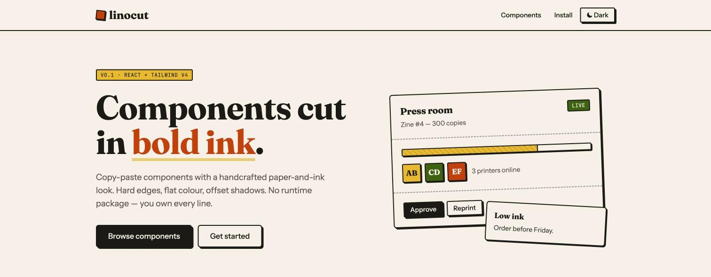

# linocut

Copy-paste React + Tailwind components with a handcrafted paper-and-ink design language.
Hard edges, flat colour, offset "stamp" shadows. No runtime package: the code lands in your repo and you own it.

**[Live demo →](https://arseniyx.github.io/linocut/)**

[](https://arseniyx.github.io/linocut/)

## Quick start

```bash
npx linocut init                       # config, design tokens, cn() util
npx linocut add button card dialog     # copy components into your project
```

`init` creates `linocut.json`, `styles/linocut.css` and `lib/utils.ts` (under `src/` if you have one), and installs the base dependencies. Import the stylesheet once in your entry point:

```ts
import "./styles/linocut.css"
```

Then use the components:

```tsx
import { Button } from "@/components/ui/button"

<Button variant="rust">Print</Button>
```

## Components

`alert` · `avatar` · `badge` · `button` · `card` · `checkbox` · `dialog` · `input` · `kbd` · `label` · `progress` · `select` · `separator` · `skeleton` · `switch` · `table` · `tabs` · `textarea`

```bash
npx linocut list          # show everything available
npx linocut add --all     # add every component
```

| Flag           | Effect                                     |
| -------------- | ------------------------------------------ |
| `--overwrite`  | replace files that already exist           |
| `--no-install` | print dependencies instead of installing   |

## Theming

All design tokens live in `styles/linocut.css` as Tailwind v4 `@theme` variables: `paper`, `ink`, `rust`, `moss`, `sun`, fonts, radii and the stamp shadows. Dark mode is a `.dark` class on a parent element. Edit the file freely.

Text on the coloured fills uses `text-on-sun`, `text-on-moss` and `text-on-rust`, which stay the same in both themes.

## Develop

```bash
npm install
npm run preview:dev      # showcase site on localhost
npm run preview:build    # production build to preview/dist
npm run typecheck
```

The showcase in `preview/` is deployed to GitHub Pages by `.github/workflows/pages.yml` on every push to `main`.

## License

MIT
